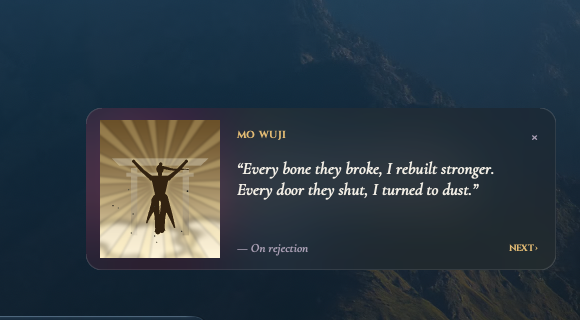

# Mo Wuji Widget

A small macOS desktop widget that keeps a motivational quote on your desktop, voiced in the spirit of **Mo Wuji**, the protagonist of the cultivation novel *Immortal Mortal* (不朽凡人) by Goose Five (鹅是老五). Beside the quote, an animated silhouette of Mo Wuji meditates, fights or ascends in one of 16 scenes.

<p align="center">
  
</p>

<p align="center">
  
</p>

## Features

- **It lives on the desktop.** The card sits above the wallpaper and below every app window, the same way macOS desktop widgets do. It shows on all Spaces and stays put in Mission Control.
- **It's frosted glass.** The card uses the native macOS blur material, so your wallpaper shows through behind the text.
- **There are 60 quotes.** A new one appears every 30 minutes, or when you click **NEXT ›**.
- **There are 16 animated scenes in three moods.** The scene changes together with the quote.
  - **Calm:** dawn meditation, moonlit bamboo, wanderer in the mist, blossom meditation, snow peak stillness, lotus lake, facing the heavens.
  - **Battle:** bamboo duel, ten thousand swords, blood moon, burning battlefield, facing the beast, lightning tribulation.
  - **God-like:** ascension, lord of the stars, heaven's gate.
- **The scenes move.** Mo Wuji breathes, hair and robes stream in the wind, and lightning, god rays, sword slashes, embers, petals, snow, rain and fireflies animate.
- **It's light on the CPU.** It renders about 5 frames a second, at around 1% of one core while visible. It stops rendering entirely while app windows cover it.
- **It stays out of the way.** It has no Dock icon, it starts at login, you can drag it anywhere, and only one copy can run at a time.


## Requirements

- macOS. Developed and tested on macOS 27 on Apple Silicon.
- Python 3.10 or newer, with **Tk 8.6**. The [python.org installer](https://www.python.org/downloads/macos/) includes it. With Homebrew, run `brew install python python-tk`. Apple's `/usr/bin/python3` ships an old Tk 8.5 and won't work.
- [Pillow](https://pypi.org/project/Pillow/).

## Install

```bash
git clone https://github.com/udhay24/mo-wuji-widget.git
cd mo-wuji-widget
python3 -m pip install -r requirements.txt
./install.sh
```

`install.sh` registers a launchd agent, so the widget starts right away and again at every login. It uses whichever `python3` is first on your `PATH`. To use a different Python, set `PYTHON`:

```bash
PYTHON=/Library/Frameworks/Python.framework/Versions/3.12/bin/python3 ./install.sh
```

To try it once without installing, run `python3 widget.py`.

## Using it

| Action | How |
|---|---|
| Next quote and scene | Click **NEXT ›** |
| Move the card | Drag it from anywhere on the card |
| Close it | Click **×** |
| Start it again after closing | `launchctl kickstart gui/$(id -u)/com.mowuji.widget` |
| See it while apps are open | Show the desktop: spread your thumb and three fingers on the trackpad, or click the wallpaper on macOS 14 and later |
| Uninstall | `./uninstall.sh` |

Errors are logged to `~/Library/Logs/mo-wuji-widget.log`.

## Customize

- **Quotes:** edit `quotes.txt`. Each line is `quote|theme`, for example:
  ```
  When there is no road, I become the road.|On forging a path
  ```
- **How often it changes:** set `REFRESH_MS` in `widget.py`.
- **Scenes:** each scene is one `Scene(...)` entry in `SCENES` in `avatar.py`. An entry sets the sky colours, the sun or moon, the ground, the pose (`seated`, `back`, `overhead`, `low_guard`, `sword_sky`, `wanderer` or `arms_open`), the particles and the effects. To add a scene, copy an entry and change it.

Restart the widget after any change with `launchctl kickstart -k gui/$(id -u)/com.mowuji.widget`.

## How it works

The widget is plain Tkinter plus Pillow. Everything native goes through `ctypes`, so it doesn't need PyObjC.

- **Desktop level:** the window's `NSWindow` level is set just above the desktop icons. Its collection behaviour makes it appear on all Spaces and stay stationary in Mission Control.
- **Glass:** an `NSVisualEffectView` (the dark HUD material, blending behind the window) is placed underneath Tk's transparent content view.
- **Pausing when covered:** `NSWindow.occlusionState` is checked before each frame, and nothing is drawn while the card can't be seen.
- **Dragging:** macOS drops mouse-move events for desktop-level windows. So during a drag, the widget polls the pointer position and the mouse button state (`CGEventSourceButtonState`).
- **Scenes:** each scene is drawn at 3× resolution and scaled down for smooth edges. The figure is a jointed skeleton of tapered limbs. Backgrounds and the rotating light rays are rendered once and cached.
- **Fonts:** [Cinzel](https://fonts.google.com/specimen/Cinzel) and [Cormorant Garamond](https://fonts.google.com/specimen/Cormorant+Garamond) are bundled in `fonts/`. They're registered for this process only with `CTFontManagerRegisterFontsForURL`, so nothing gets installed on your system.

## Credits and disclaimer

This is an unofficial fan project, not affiliated with Goose Five, the publishers or Webnovel. *Immortal Mortal* and Mo Wuji belong to their author. The quotes are original lines written in the character's spirit. They are **not** taken from the novel.

The fonts are licensed under the SIL Open Font License; see `fonts/OFL-*.txt`. The code is under the MIT License; see [LICENSE](LICENSE).
