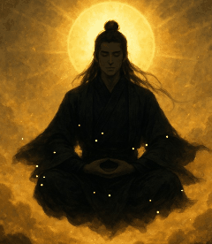
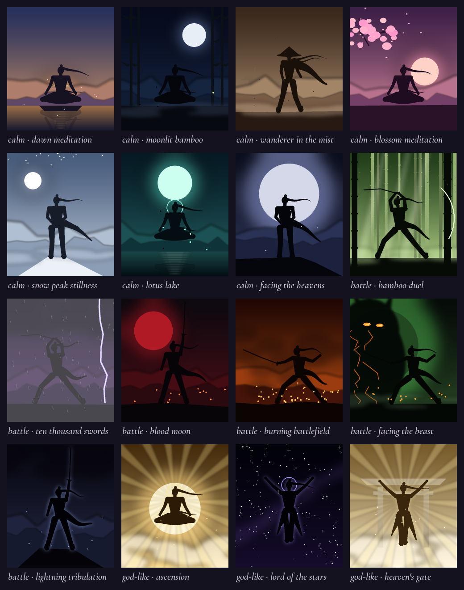

# Mo Wuji Widget

A macOS desktop widget that keeps a motivational quote on your desktop, voiced in the spirit of **Mo Wuji**, the protagonist of the cultivation novel *Immortal Mortal* (不朽凡人) by Goose Five (鹅是老五). Beside the quote, a painted scene of Mo Wuji meditating, fighting or ascending matches the quote's mood and the time of day. A built-in focus timer, closed-door cultivation, tracks your daily goal.

<p align="center">
  
</p>

## Features

- **It lives on the desktop.** The card sits above the wallpaper and below every app window, the same way macOS desktop widgets do. It's frosted glass, so your wallpaper shows through, and it appears on all Spaces.
- **There are 120 quotes.** A new one appears every 30 minutes, or when you click **NEXT ›**. Each quote is tagged calm, battle or god-like.
- **There are 16 painted, animated scenes in three moods.** The scene follows the quote's mood and the time of day: dawn, day, dusk or night. Paintings drift slowly, with embers, petals, snow, rain, fireflies and lightning animated on top.
  - **Calm:** dawn meditation, moonlit bamboo, wanderer in the mist, blossom meditation, snow peak stillness, lotus lake, facing the heavens.
  - **Battle:** bamboo duel, ten thousand swords, blood moon, burning battlefield, facing the beast, lightning tribulation.
  - **God-like:** ascension, lord of the stars, heaven's gate.
- **Closed-door cultivation.** A focus timer of 25, 50 or 90 minutes, with an optional intention ("what will you work on?") and a daily goal. A summary shows a 7-day chart, your streak and all-time totals. When a session ends you get a breakthrough screen and a notification. If the widget restarts mid-session, the session carries on.
- **An optional AI voice.** With an [OpenRouter](https://openrouter.ai) key, Mo Wuji also:
  - writes new quotes for the moment, hinting at the time of day and your progress
  - answers each finished session with a short debrief about what you worked on
  - writes a short chronicle of your week, shown in the summary

  Without a key, or offline, everything falls back to the built-in text.
- **It's light on the CPU.** It renders about 5 frames a second through Core Animation, at about 4% of one core while visible. It stops rendering while app windows cover it, and then uses about 0.3%.
- **It stays out of the way.** It has no Dock icon, it starts at login, and only one copy can run at a time. You can drag it anywhere, and it remembers where you put it.



## Requirements

- macOS. Developed and tested on macOS 27 on Apple Silicon.
- Python 3.10 or newer, with **Tk 8.6**. The [python.org installer](https://www.python.org/downloads/macos/) includes it. With Homebrew, run `brew install python python-tk`. Apple's `/usr/bin/python3` ships an old Tk 8.5 and won't work.
- [Pillow](https://pypi.org/project/Pillow/).

## Install

```bash
git clone https://github.com/udhay24/mo-wuji-widget.git
cd mo-wuji-widget
python3 -m pip install -r requirements.txt
./install.sh
```

`install.sh` registers a launchd agent, so the widget starts right away and again at every login. It uses whichever `python3` is first on your `PATH`. To use a different Python, set `PYTHON`:

```bash
PYTHON=/Library/Frameworks/Python.framework/Versions/3.12/bin/python3 ./install.sh
```

To try it once without installing, run `python3 widget.py`.

### Optional: the AI voice

Store your OpenRouter key in the macOS Keychain. The command prompts for the key, so it never lands in your shell history:

```bash
security add-generic-password -s mo-wuji-widget -a openrouter -w
```

Then restart the widget. Text uses NVIDIA's free `nvidia/nemotron-3.5-super-vl:free`. When that endpoint is busy or withdrawn, OpenRouter falls back to `mistralai/mistral-nemo`, which costs a few millionths of a dollar per quote. To use different models, change `MODEL` and `FALLBACK_MODELS` in `voice.py`. Free endpoints may log prompts, and your session intentions are part of the prompts. Small models sometimes slip, so generated quotes that run words together, contain numbers or mention the app's mechanics are discarded, and a built-in quote is shown instead.

## Using it

| Action | How |
|---|---|
| Next quote and scene | Click **NEXT ›** |
| Start a focus session | Click **CULTIVATE** or the "2 of 4 today" counter. Choose a length and a daily goal, type an intention if you like, then click **BEGIN ›** or press Return. |
| Stop a session early | Click **END EARLY**, then **END**. A session ended early isn't counted. |
| Move the card | Drag it from anywhere on the card |
| Resize the card | Drag the grip in the bottom-right corner. It scales from 80% to 180%, and the size is remembered. |
| Close it | Click **×** |
| Start it again after closing | `launchctl kickstart gui/$(id -u)/com.mowuji.widget` |
| See it while apps are open | Show the desktop: spread your thumb and three fingers on the trackpad, or click the wallpaper on macOS 14 and later |
| Uninstall | `./uninstall.sh` |

Errors are logged to `~/Library/Logs/mo-wuji-widget.log`. Your sessions, goal, card position and size, and generated text are saved in `~/Library/Application Support/mo-wuji-widget/state.json`.

## Customize

- **Quotes:** edit `quotes.txt`. Each line is `quote|theme|mood`, where mood is `calm`, `battle` or `god-like`. For example:
  ```
  When there is no road, I become the road.|On forging a path|calm
  ```
- **Paintings:** each scene shows `art/<scene-name>.jpg` when that file exists, and a drawn silhouette when it doesn't. `python3 paint.py` paints any missing scenes with OpenAI's `gpt-5-image-mini` through your OpenRouter key. Your OpenRouter activity page shows the exact cost. Use `python3 paint.py --force "blood moon"` to repaint one scene. The prompts are in `paint.py`.
- **Scenes:** each scene is one `Scene(...)` entry in `SCENES` in `avatar.py`. An entry sets the mood, the particles, the effects, and the drawn fallback (sky, sun or moon, ground and pose). The parts of the day each scene suits are in `SCENE_TIMES`.
- **How often it changes:** set `REFRESH_MS` in `widget.py`.

Restart the widget after any change with `launchctl kickstart -k gui/$(id -u)/com.mowuji.widget`.

## How it works

The widget is plain Tkinter plus Pillow. Everything native goes through `ctypes`, so it doesn't need PyObjC.

- **Desktop level:** the window's `NSWindow` level is set just above the desktop icons. Its collection behaviour makes it appear on all Spaces and stay stationary in Mission Control.
- **Glass:** an `NSVisualEffectView` (the dark HUD material, blending behind the window) is placed underneath Tk's transparent content view.
- **Pausing when covered:** `NSWindow.occlusionState` is checked before each frame, and nothing is drawn while the card can't be seen.
- **Clicks and dragging:** while another app is active, macOS drops most clicks on a desktop-level window, though hover events still arrive. So while the pointer is over the card, the widget reads the mouse button itself (`CGEventSourceButtonState`) and works out which control is under the pointer. Drags follow the pointer the same way.
- **Typing:** a desktop-level window only takes keyboard input once the app is active. So clicking the intention box activates the app and makes the card the key window.
- **AI calls** run on a worker thread, and their results are handed back to Tk on the main thread, so the card never freezes. The next quote is fetched ahead of time, so it's ready the moment it's needed.
- **Font:** [Lora](https://fonts.google.com/specimen/Lora) (SemiBold and Medium Italic) is bundled in `fonts/`. It's registered for this process only with `CTFontManagerRegisterFontsForURL`, so nothing gets installed on your system.

## Credits and disclaimer

This is an unofficial fan project, not affiliated with Goose Five, the publishers or Webnovel. *Immortal Mortal* and Mo Wuji belong to their author. The built-in quotes are original lines written in the character's spirit. They are **not** taken from the novel.

The scene paintings are AI-generated: five with Canva's image generator, and eleven with OpenAI's `gpt-5-image-mini` via OpenRouter. The fonts are licensed under the SIL Open Font License; see `fonts/OFL-*.txt`. The code is under the MIT License; see [LICENSE](LICENSE).
